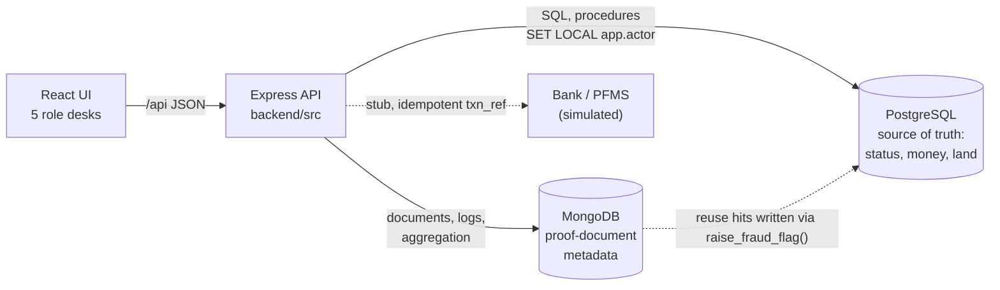
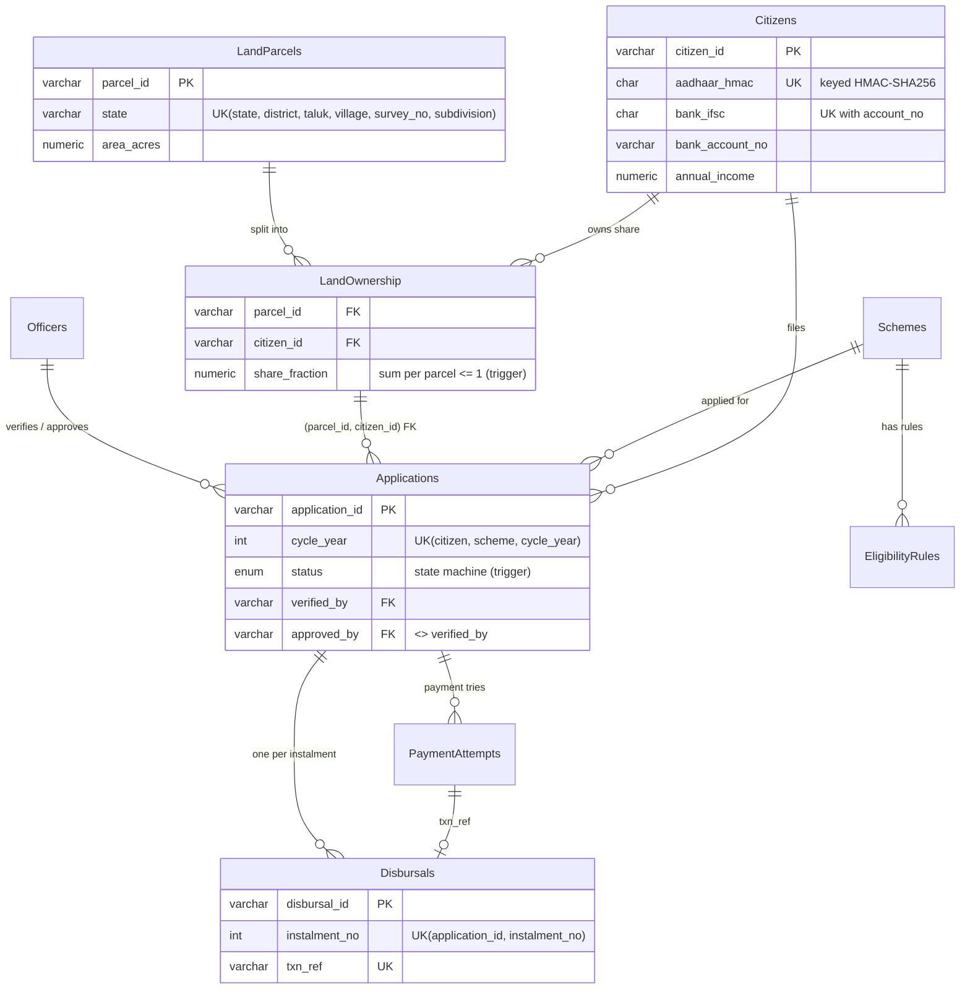

# Namma Raitha DBT: Subsidy Eligibility and Disbursal Tracking System

A DBMS course project. Farmers apply for government schemes (PM-Kisan, PM-KUSUM, drip irrigation and others). The system checks eligibility, moves each application through **apply → verify → approve → pay**, and makes sure money moves **exactly once, to someone who qualifies, with a record of who did what**. It also catches the classic fraud patterns: ghost beneficiaries, shared "mule" bank accounts, reused identity documents, and double payouts under concurrency.

The important rules are enforced **inside the database** (constraints, triggers, stored procedures, row locks, RLS), not in the UI. Everything in the demo is real: every fraud flag you see was written by a trigger or an aggregation pipeline, and the race-condition lab runs real concurrent transactions.

| Layer | Tech |
|---|---|
| Transactional data (citizens, land, applications, money) | **PostgreSQL 14+** (3NF, triggers, PL/pgSQL, pg_trgm, pgcrypto, RLS) |
| Proof-document metadata, verification logs | **MongoDB 6+** (`$jsonSchema` validators, aggregation pipeline) |
| API | Node.js 18+ / Express (`backend/`) |
| UI | React 19 + Vite + Tailwind 4 (`frontend/`) |

**Team:** Sakshi (backend, database), TEAMMATE_NAME (frontend).

---

## Quick start

You need Node.js 18+ and both databases running.

### 1. Start the databases

**Option A: Docker** (easiest)
```bash
docker compose up -d          # PostgreSQL on 5432 (postgres/postgres), MongoDB on 27017
```

**Option B: native installs.** Install PostgreSQL and MongoDB Community Server, then create the database:
```bash
psql -U postgres -c "CREATE DATABASE subsidy_dbt;"
```
`pg_trgm` and `pgcrypto` ship with standard PostgreSQL builds (they're in `contrib`).

### 2. Start the API
```bash
cd backend
cp .env.example .env          # Windows: copy .env.example .env  (then edit DATABASE_URL if your password differs)
npm install
npm start                     # http://localhost:4000. On first run it builds the schema + demo data automatically
```

### 3. Start the UI
```bash
cd frontend
npm install
npm run dev                   # http://localhost:5173
```

The black strip under the header shows whether PostgreSQL and MongoDB are live. **Reset demo database** rebuilds both from `database/schema.sql` and the seed story at any time.

### Tests and experiments
```bash
cd backend
npm test                      # 24 integration tests against a scratch DB (subsidy_test)
npm run benchmark             # 50k synthetic farmers; writes docs/RESULTS.md + docs/benchmark-results.json
psql -U postgres -d subsidy_dbt -f ../database/demo_rls.sql   # Row-Level Security demo
```

---

## Architecture



**Why two databases.** Money, eligibility and land ownership need strict consistency and relational integrity, so they live in PostgreSQL. Proof documents differ per scheme and per state: Karnataka issues an RTC/Pahani, Punjab a Jamabandi, UP a Khasra, and a tractor subsidy also needs a dealer quotation. That metadata is document-shaped and is queried as whole records, so it lives in MongoDB.

**Who owns the truth.** There is no transaction that spans both databases. PostgreSQL is the single source of truth for application status. The API commits to PostgreSQL first and writes MongoDB second. If the MongoDB write fails, the application still exists and the UI shows "document metadata unavailable". The status is never wrong.

### ER diagram (PostgreSQL)


Also: `FraudFlags`, `AuditLog`, and `RaceDemoLedger` (a teaching table with no constraints, used only by the race lab). `claimed_area_acres` is a **view** (`v_ownership`) rather than a stored column, because storing share × area would be a transitive dependency and could drift out of sync.

---

## Where each DBMS concept lives

| Concept | Database object (`database/schema.sql`) | See it in the UI | Test |
|---|---|---|---|
| Composite keys (Fix 1, 4) | `uq_parcel_location`, `uq_bank_account` | Register farmer → presets | `survey number 104…`, `same account number at a DIFFERENT bank…` |
| 3NF decomposition (Fix 2) | `LandParcels` + `LandOwnership` + view `v_ownership` | Citizen card shows shares | `ghost beneficiary…` |
| Trigger: fraud quarantine | `trg_screen_new_citizen`, `trg_check_parcel_share` | Vigilance → Fraud injection | `quarantine…` |
| Stored procedure (Fix 7) | `check_citizen_eligibility()` (generic rule rows) | Apply modal → EXECUTE | `eligibility…` |
| State machine trigger | `trg_status_flow` | Verifier / payment desks | `state machine…` |
| Separation of duties | `trg_separation_of_duties`, `chk_verifier_not_approver`, `Officers.can_*` | Approve as the verifier | `separation of duties…` |
| Transactions + row locks (Fix 3, 9) | `initiate_payment()` (`FOR UPDATE`), `complete_payment()`, `PaymentAttempts` | Approval & Payment → Race Condition Lab | `race, real path…` |
| UNIQUE as a backstop | `uq_application_instalment` | Race lab "No row lock" mode | `race, no lock…` |
| Append-only ledger | `trg_disbursal_immutable` (+ TRUNCATE guard) | Ledger tab | `ledger is append-only…` |
| Audit trail | generic `audit_row_change()` reading `app.actor` | Vigilance → Audit Trail | `audit trigger…` |
| Indexes | B-tree composites, GIN `gin_trgm_ops` | DBMS Internals → Benchmarks | `npm run benchmark` |
| Fuzzy matching | `pg_trgm` `similarity()` / `%` | Seed flag for "Basavaraaj Gowda" | `seed story…` |
| Keyed hashing (Fix 5) | `aadhaar_hmac` (key only in API env; matches `pgcrypto.hmac()`) | Citizen card | `Aadhaar keyed hash…` |
| Roles, privileges, RLS | `citizen_role`, `agent_role`, `admin_role`, policies, column `GRANT` | `database/demo_rls.sql` | `RLS…`, `column privilege…` |
| MongoDB validation + aggregation (Fix 6, 10) | `backend/src/documents.js` | Vigilance → "Reused Doc" | `MongoDB: aggregation…` |

### Design notes worth defending in the viva

- **Why the fraud triggers `RETURN NULL` instead of `RAISE EXCEPTION`.** An exception rolls back the whole transaction, including the `FraudFlags` row the trigger just wrote, and PostgreSQL has no autonomous transactions. Returning `NULL` from a `BEFORE` trigger skips just that row. The suspect row is kept as JSON evidence in the flag, and the flag commits. The UNIQUE constraints stay underneath as the hard backstop (a test disables the trigger and checks this).
- **Two payment transactions, not one.** The bank transfer is an external call, and a `COMMIT` cannot recall money once it has left. `initiate_payment()` locks the row (`WHERE status = 'approved' FOR UPDATE`) and moves it to `payment_initiated`. Then the bank is called with an idempotent `txn_ref`. Then `complete_payment()` writes the ledger row, or returns the application to `approved` if the bank failed. Replaying `complete_payment()` is a no-op.
- **What a second officer sees (READ COMMITTED).** They block on the row lock. When the first officer commits, PostgreSQL re-evaluates the `WHERE status = 'approved'` against the new row version, finds `payment_initiated`, and returns 0 rows, so the second call fails cleanly with `NOT_PAYABLE`. The race lab's three modes measure this: the real path gives 1 ledger row. Without the lock, the UNIQUE constraint still gives 1 row and the losers get `unique_violation`. Without either, you get 1 row per worker.
- **Instalments.** After a successful instalment the status becomes `partially_paid`, not `approved`. An approver must release the next instalment explicitly, so a late duplicate click can't pay instalment 2 immediately.
- **Security definer.** The audit and screening functions run as the owner, so restricted roles (e.g. `agent_role`) still get audited and screened without being given write access to `AuditLog` or `FraudFlags`.
- **Why MongoDB rather than PostgreSQL JSONB?** Honest answer: JSONB would work technically. MongoDB earns its place here through per-collection `$jsonSchema` validation, a document-centric access pattern (load or update one application's whole document set), and the aggregation pipeline that groups on the identifiers extracted from documents.

---

## Measured results (`docs/RESULTS.md`)

From the 50,006-citizen run (PostgreSQL 16; full tables, plans and caveats in [docs/RESULTS.md](docs/RESULTS.md)):

- **Planted fraud caught:** 30/30 duplicate accounts, 20/20 Aadhaar reuses, 50/50 parcel over-allocations. Honest side effect: 103 of 200 legitimate sign-ups with common names raised MEDIUM "similar name" review flags. That is why name similarity flags for review and does not block.
- **Indexes:** the duplicate-account lookup takes 3.9 ms as a sequential scan and 0.026 ms with its index. The fuzzy name match takes 113 ms and 6.4 ms. The low-selectivity `status = 'verified'` query gains nothing: the planner keeps its sequential scan.
- **Concurrency:** across 5, 10, 20 and 40 workers (5 trials each), the real path and the "no lock" path always ended with 1 ledger row. "No lock, no UNIQUE" always ended with one row per worker.

Your numbers will differ by machine. Re-run `npm run benchmark` and the DBMS Internals tab picks up the new file.

---

## Demo walkthrough (about 5 minutes)

1. **Citizen / Farmer** → *Register new farmer* → *Register*. Then *Apply for New DBT Scheme* → *EXECUTE check_citizen_eligibility()* → submit.
2. Try the presets in *Register new farmer*. "Reuse someone's bank account" is quarantined by `trg_screen_new_citizen`. "Claim an already-full parcel" is quarantined by `trg_check_parcel_share`.
3. **Verifying Agent** → *Start Field Review*. Switch the officer to `OFFICER_APPROVER_02` and press *Certify*: `trg_separation_of_duties` refuses because that officer lacks `can_verify`. Switch back to `OFFICER_VERIFIER_10` and certify.
4. **Approval & Payment** → choose `BDO_07` and try to approve `APP-2026-0003`. BDO_07 verified it, so the separation-of-duties trigger refuses. Approve with `OFFICER_APPROVER_02`, then release the payment. Also try *Simulate bank failure*.
5. **Race Condition Lab**: run *No lock, no UNIQUE* (money leaks), then *No row lock* (UNIQUE saves you), then *Real code path* (the lock saves you, cleanly).
6. **Vigilance**: inject each fraud pattern, run the scan, freeze a citizen, resolve a flag, read the audit trail.
7. **DBMS Internals**: the live DDL (imported from `database/schema.sql`), the viva Q&A, and the measured benchmarks.

---

## API

| Method | Path | Does |
|---|---|---|
| GET | `/api/health`, `/api/state` | status; full read model for the UI |
| POST | `/api/citizens`, `/api/parcels`, `/api/ownership` | register (through screening triggers) |
| GET | `/api/eligibility?citizen_id&scheme_id&parcel_id` | calls `check_citizen_eligibility()` |
| POST | `/api/applications` | submit (PostgreSQL) + document set (MongoDB) |
| POST | `/api/applications/:id/status` | `under_review`, `verified`, `rejected` |
| POST | `/api/applications/:id/approve`, `/release-next`, `/disburse` | approval and two-phase payment |
| POST | `/api/race` | `{ application_id, workers, mode: safe \| no_lock \| no_defence }` |
| POST | `/api/fraud/inject`, `/api/fraud/scan`, `/api/fraud/:id/resolve`, `/api/citizens/:id/freeze` | vigilance |
| POST | `/api/reset` | rebuild schema + seed |

Refusals come back as HTTP 409 with `blocked: { mechanism, code, status }`, naming the constraint or trigger that refused.

## Project structure
```
database/schema.sql        all tables, constraints, triggers, procedures, roles, RLS
database/demo_rls.sql      runnable RLS / privilege demo
backend/src/               config, db, crypto, documents (MongoDB), services, seed, server
backend/tests/             integration tests (node:test)
backend/scripts/           seed + benchmark
frontend/src/              React app (api.ts, App.tsx, components/)
docs/                      RESULTS.md, benchmark-results.json
docker-compose.yml         PostgreSQL 16 + MongoDB 7
```

## Limitations (stated plainly)

- Document upload and OCR are simulated. The API generates the metadata a real pipeline would extract. The bank (PFMS) is a stub with configurable latency.
- The API connects as the table owner, which bypasses RLS. RLS and column privileges are enforced for the restricted roles and demonstrated in `demo_rls.sql` and the tests. A production API would connect with per-role credentials.
- The officer is chosen from a dropdown. There is no login; the database checks each officer's permissions.
- Benchmark data is synthetic and the name pool is small (see RESULTS.md).
- The Aadhaar numbers in the seed data are made up. Never put real ones in a demo.
